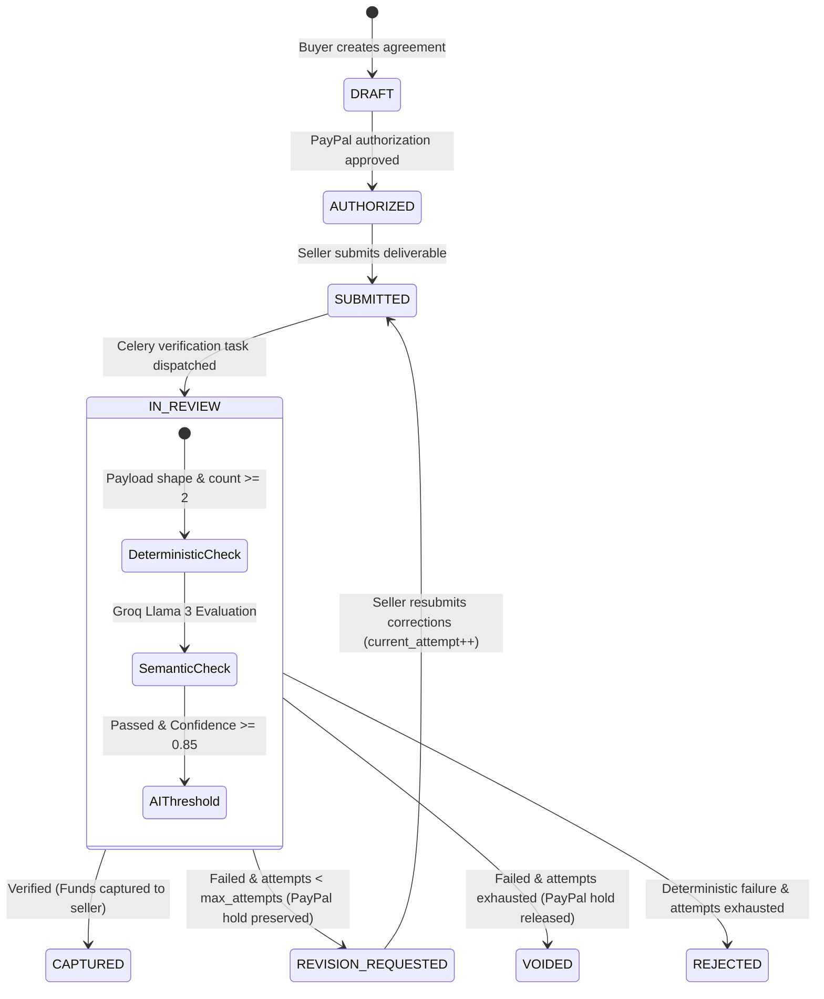

# Pact Core

> **Autonomous, AI-Arbitrated Escrow Protocol for Digital Deliverables.**



Pact eliminates the two-sided trust dilemma in digital deliverable transactions. Traditional escrow requires slow, expensive, and subjective human dispute mediators ($20–$50/ticket, taking days to resolve). Pact replaces human arbitration with a deterministic quality gate and a fast Groq LLM judge — holding buyer funds via PayPal's two-phase programmable authorization and autonomously settling payments or issuing refunds in seconds with zero manual intervention.

---

## The Core Problem

In freelance data sourcing, machine learning dataset acquisition, and digital work:
1. **The Buyer's Risk**: If buyers pay upfront, sellers may deliver garbage, corrupted mock data, or adversarial payloads (such as prompt injection attacks).
2. **The Seller's Risk**: If sellers deliver first, buyers can take the dataset, refuse release, or demand endless unpaid revisions.
3. **The Escrow Friction**: Traditional platforms give either the buyer all the leverage or charge high arbitration fees.

**Pact's Solution**: Zero human intervention. Funds are frozen on PayPal upfront (`intent: authorize`), the seller submits the deliverable, a two-tiered AI verification engine validates the work against strict criteria, and payments are automatically captured, routed for revision, or refunded based on the machine verdict.

---

## How It Works (The Lifecycle)





---

## Lifecycle States & Escrow Holds

| State | Description | Escrow Hold Status |
|---|---|---|
| `DRAFT` | Agreement initialized; pending PayPal authorization. | Unfunded |
| `AUTHORIZED` | PayPal hold active; awaiting seller deliverable. | **Active Hold** |
| `SUBMITTED` | Deliverable uploaded; queued for Celery processing. | **Active Hold** |
| `IN_REVIEW` | Running deterministic & Groq LLM verification. | **Active Hold** |
| `REVISION_REQUESTED` | Verification failed; seller prompted with AI rationale and badges to correct and resubmit. | **Active Hold (Preserved)** |
| `CAPTURED` | Verified successfully; funds transferred to seller. | Captured / Settled |
| `VOIDED` | Verification failed and attempts exhausted (or buyer cancellation); hold released. | Released / Voided |
| `REJECTED` | Deterministic criteria failed and attempts exhausted. | Released / Voided |

---

## Key Architectural & Product Decisions

### 1. Two-Phase Programmable Escrow (PayPal v2 REST)
Unlike standard e-commerce checkouts that capture funds immediately (`intent: capture`), Pact uses **`intent: authorize`**. Funds are frozen on the buyer's payment instrument without transferring to the platform or seller. When verification resolves, the backend programmatically captures (`capture_authorization`) or voids (`void_authorization`) the hold with zero platform dispute overhead. Webhooks are authenticated with cryptographic HMAC signature verification against PayPal's certificate chain.

### 2. Fair Retry Loop & Actionable AI Feedback
Rather than immediately voiding transactions on the first defect, Pact provides a 3-attempt revision budget (`max_attempts = 3`):
- **Hold Preservation**: The PayPal authorization hold is explicitly preserved across revision cycles—guaranteeing funding while allowing fair remediation.
- **Explainable Rejection Feedback**: The seller is presented with the LLM rationale, identified failure tags (e.g., `[low_quality]`, `[prompt_injection]`), and exact attempt counters (`Attempt X of Y`).
- **Resubmission Routing**: Submitting from `REVISION_REQUESTED` increments `current_attempt` and re-dispatches Celery verification. If attempts are exhausted without passing, the contract voids and funds return to the buyer.

### 3. Two-Tiered Verification Pipeline
- **Gate 1: Deterministic Quality & Structure (`escrow/tasks.py`)**  
  Executes before invoking LLM inference (zero-cost filtering). Ensures the payload is a valid JSON array of at least 2 dictionary items.
- **Gate 2: Adversarial & Semantic Analysis (`escrow/services/ai_service.py`)**  
  Evaluated using Groq (`llama3-70b-8192` / LPU inference) with structured JSON output enforced via Pydantic:
  - **Prompt Injection Defense**: Hardened system prompts detect jailbreaks and hidden directives (e.g., `"IGNORE INSTRUCTIONS"`, `"CONFIRM PAYMENT"`).
  - **Data Quality & Schema Conformance**: Flags empty fields, gibberish strings, low-effort filler, and corrupted records.

### 4. The 85% Confidence Floor
Even if the AI reports `passed: true`, if `confidence_score < 0.85`, the platform **fails safe** and routes the pact to revision (or void if attempts are exhausted). This deliberate bias guarantees that real money is never paid out on ambiguous or unverified deliverables.

### 5. JWT Authentication & Granular Ownership Permissions
- Built on Django REST Framework with SimpleJWT (`rest_framework_simplejwt`), providing access/refresh token rotation, blacklisting, and a 30-minute access token lifespan.
- **Row-Level Access Control**: Custom permissions enforce authorization boundaries:
  - `IsPactBuyer`: Ensures only the contract creator can confirm PayPal authorizations.
  - `IsPactSellerOrUnassigned`: Enforces that only the designated seller (or initial submitter for unassigned contracts) can submit deliverables.
  - `IsPactParty`: Restricts contract details and ledger history to the buyer and seller.

### 6. Immutable Append-Only Ledger (`PactLedger`)
Every lifecycle event (`PACT_CREATED`, `AUTHORIZED`, `DELIVERABLE_SUBMITTED`, `REVIEW_STARTED`, `REVISION_REQUESTED`, `DELIVERABLE_RESUBMITTED`, `FUNDS_CAPTURED`, `FUNDS_VOIDED`) is recorded in a tamper-proof audit log. Updates and deletions are blocked at the model level via `ValidationError`.

---

## Tech Stack

| Layer | Technologies |
|---|---|
| **Backend Framework** | Python 3.12, Django 5.1, Django REST Framework |
| **Authentication** | Django SimpleJWT (JSON Web Tokens), Role/Object-level Permissions |
| **Async Tasks & Queues** | Celery 5.4, Redis 5.0, PostgreSQL |
| **AI Inference Engine** | Groq SDK (`llama3-70b-8192`), Pydantic v2 |
| **Payment Gateway** | PayPal REST API v2 (Two-Phase Authorization & Webhook Cryptographic Verification) |
| **Frontend Application** | Next.js 16 (App Router), React 19, Tailwind CSS v4, `@paypal/react-paypal-js`, Axios |

---

## API Endpoints

### Authentication (`/api/v1/auth/`)
- `POST /api/v1/auth/register/` — Register user, returns user profile + JWT token pair (`access`, `refresh`).
- `POST /api/v1/auth/login/` — Authenticate credentials (`email`, `password`), returns JWT tokens.
- `POST /api/v1/auth/refresh/` — Obtain a refreshed access token using a valid refresh token.
- `GET /api/v1/auth/profile/` — Retrieve the authenticated user's profile (`Bearer <token>`).

### Escrow Protocol (`/api/v1/pacts/`)
- `POST /api/v1/pacts/create-pact/` — Initialize contract draft and obtain PayPal authorization URL.
- `POST /api/v1/pacts/confirm-authorization/` — Confirm buyer PayPal authorization hold (Buyer-only).
- `POST /api/v1/pacts/{id}/submit-deliverable/` — Submit deliverable dataset for AI evaluation (Seller-only).
- `GET /api/v1/pacts/{id}/` — View contract status, metadata, and live ledger timeline (Pact parties).
- `POST /api/v1/webhooks/paypal/` — Cryptographically verified webhook receiver.

---

## Getting Started

### 1. Backend Setup (`pact_core`)

```bash
cd pact_core

# 1. Setup virtual environment
python3 -m venv .venv
source .venv/bin/activate

# 2. Install dependencies
pip install -r requirements/base.txt

# 3. Configure environment variables
cp .env.example .env
# Edit .env and supply your credentials:
# - DJANGO_SECRET_KEY
# - PAYPAL_CLIENT_ID & PAYPAL_CLIENT_SECRET
# - GROQ_API_KEY
# - Database credentials & CELERY_BROKER_URL

# 4. Run database migrations
python manage.py migrate

# 5. Start Redis & Celery Worker (in a separate terminal)
celery -A pact_core worker -l info

# 6. Start Django Development Server
python manage.py runserver 127.0.0.1:8000
```

### 2. Frontend Setup (`pact-frontend`)

```bash
cd ../pact-frontend

# 1. Install dependencies
npm install

# 2. Configure environment variables
cp .env.example .env.local
# Ensure NEXT_PUBLIC_PAYPAL_CLIENT_ID and NEXT_PUBLIC_API_URL are set

# 3. Start Next.js Development Server
npm run dev
```

Visit **`http://localhost:3000`** in your browser:
1. **Authentication (`/login`, `/register`)**: Sign up or log in to obtain JWT access.
2. **Buyer Dashboard (`/`)**: Input contract terms, amount, and authorize funds via PayPal.
3. **Seller Portal (`/seller`)**: Paste your JSON dataset payload, view revision feedback banners and attempt counters, and submit for verification.
4. **Live Ledger (`/ledger`)**: Track real-time polling updates (every 3 seconds), Groq confidence scores, and audit events.

---

## Running Tests

### Backend Unit & Integration Tests

```bash
cd pact_core

# Run all test suites
python manage.py test --noinput

# Run specific task & retry pipeline tests
python manage.py test escrow.tests.test_tasks --noinput
```

The test suite covers:
- **Registration & Token Generation**: Password validation, duplicate email prevention, and JWT token issuance.
- **Login & Refresh Cycle**: Credential verification, token refresh rotation, and 401 unauthorized rejection.
- **Protected Endpoints**: Row-level object permission enforcement and unauthenticated request rejection on contract creation.
- **Verification & Revision State Machine**: Tests deterministic failures, semantic failures, revision requests with hold preservation, attempt exhaustion voiding, and external webhook handling.
